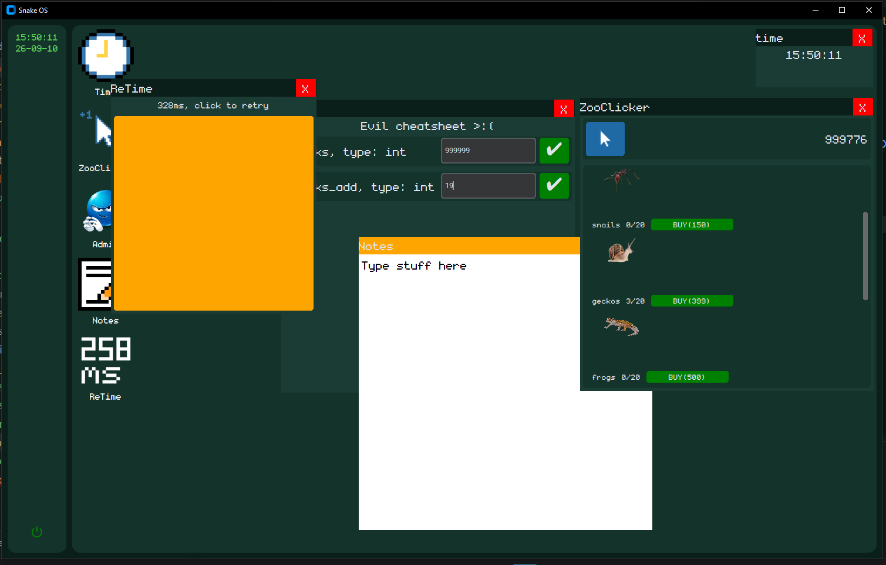

# SnakeOS

A tiny fake os coded in python :)

### Apps:
1. Time: self explanatory, doesn't show date!
2. ZooClicker: cool lil clicker game
3. Admin: a cheat for ZooClicker >:)
4. Notes: self explanatory again
5. ReTime: reaction time testing appy(try to beat my personal best of 190 WITHOUT PRE FIRING)

### Other:
 - Sidebar with a shutdown button and time(this time with the current date, time app++ legitt)
 - Breathing animation for the time display label(most important feature so i had to mention it)

## How to try

1. Install the zip from the latest release
2. Install the font included in the report(monogram.ttf)
3. Launch exe

*Note for reviewers: If you don't want to install the zip or the exe, i included a video showing everything in the repo*        
*Note: If you wanna experiment with the code of the OS, you can code your own app using utility.py and main.py! -Might be hard tho*

## How it works

Firstly, here are the python libs it uses(4)
 - Image from PIL(loading images)
 - time
 - customtkinter(ui library)
 - pygame(for sound)

The OS has 2 crucial files, utility.py and main.py

Main.py:
- Setup and the main ui(workspace + the sidebar + whatever the siderbar has with at the moment is the shutdown button and the time label)
Utility.py:
- Has functions for creating app widgets, creating windows, opening images, adding buttons to the sidebar and the update_loop that apps can use

The update loop enables dragging and updating apps at around 40 fps(25 ms)    
*Note for people who want to code their own apps: If you want your app to update, append your update function to the utility.todo list
e.g. utility.todo.append(update_time)*

